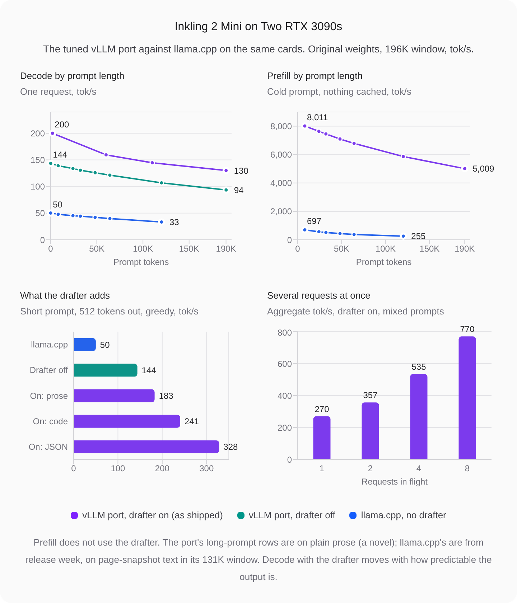

# Inkling 2 Mini, 2x RTX3090 vLLM edition

vLLM does not run [Inkling 2 Mini](https://huggingface.co/thinkingmachines/Inkling-2-Mini) natively on Ampere cards. Here I've patched the official vLLM docker image with Ampere support and tuned it to make it fast. The base serving config is for dual RTX 3090s using an NVLink bridge. Other sm_86 cards and pairs without a bridge are reported to work with patches like these, but I haven't tested them with this config.

> **Updated November 23, 2026.** A faster build since the first release, on the same weights and the same unquantized KV cache:
>
> - Prefill is about 13% faster on prompts of 8K tokens and up, and 3% to 13% faster on prompts of 1.5K to 7K. A cold 120K prompt reaches its first token in 20.5 seconds, down from 23.
> - Decode with the drafter is about 7% faster: 183 to 328 tok/s depending on the kind of output, up from 170 to 306.
> - The KV pool is larger, so the same cards can serve much longer windows if you change the flags: up to 426K with images and the drafter, or 590K text only. The default is still 196K.
> - Images can be up to 3584×3584 px, up from about 2080×2080.
> - Long-prompt numbers are now measured on plain prose. The first release measured them on repetitive text, which made decode with the drafter look faster at depth than it is.
>
> To pick it up: `git pull`, `docker compose build`, `docker compose up -d`. What changed and how it was checked is in [NOTES.md](NOTES.md#tuning) and [BENCH.md](BENCH.md).

<p align="center">
  <picture>
    <source media="(prefers-color-scheme: dark)" srcset="assets/speed-overview-dark.png">
    
  </picture>
</p>

[Full write up on the porting process](https://peaster.io/articles/local-LLMs/inkling-2-mini-first-impressions) and [Reddit discussion](https://www.reddit.com/r/LocalLLaMA/comments/1y2gxo7/inkling_absolutely_rips_200_toks_decode_6700/)

Measurements for the chart are in [BENCH.md](BENCH.md). How the port works, what the tuning changed, long-window configs and how it compares with the other Ampere ports are in [NOTES.md](NOTES.md).

## Serving

You need:

| | |
|---|---|
| GPUs | two sm_86 cards with 24 GB each. The quoted numbers come from my RTX 3090s connected via NVLink bridge. YMMV. Other cards and bridgeless pairs are untested with this config, and without a bridge you may need `--disable-custom-all-reduce`. See [other setups](NOTES.md#other-setups) |
| Driver | one that supports CUDA 13 (the image is torch 2.14.0+cu130). Tested with 620.73.04 |
| Docker | with the NVIDIA Container Toolkit. Tested with Docker 29.10, Compose 5.8, toolkit 1.20.1 |
| Disk | A total of 46GB disk space is required. 26 GB for the image and 20 GB for the checkpoint |

To start the server:

```bash
git clone https://github.com/peaster/inkling-2-mini-vllm-2x3090
cd inkling-2-mini-vllm-2x3090

hf download thinkingmachines/Inkling-2-Mini   # 20 GB into ~/.cache/huggingface
docker compose build                          # pulls the 9.3 GiB base image, downloads one wheel, patches
docker compose up -d
docker compose logs -f                        # ready at "Application startup complete"
```

```bash
curl -s localhost:8000/v1/chat/completions -H 'Content-Type: application/json' -d '{
  "model": "inkling-2-mini",
  "messages": [{"role": "user", "content": "Name three uses for a spare GPU."}],
  "max_tokens": 2048,
  "chat_template_kwargs": {"reasoning_effort": "low"}
}'
```

Boot takes about 40 seconds once everything is cached, and around 90 the first time (longer if the checkpoint sits on slow storage). The first long prompt after a cold boot is also a few seconds slow while kernels compile.

The checkpoint is read from `~/.cache/huggingface` and never downloaded at boot, so run the `hf download` step first. The API is on port 8000 with no key. There's a note in `docker-compose.yml` if you'd rather bind it to localhost.

### Inference notes

- Always set `max_tokens`. The model can get stuck reasoning in circles, and it will keep going until it hits the cap.

- Reasoning effort goes in `reasoning_effort`, or `chat_template_kwargs: {"reasoning_effort": "low"}`. The levels are `none`, `minimal`, `low`, `medium`, `high` and `xhigh`. The default is `high`, and `none` still reasons a little. Reasoning comes back in the `reasoning` field, and tool calls use the `inkling` parser. This model struggles with very high reasoning efforts. Recommended to use the `high` setting for the coding agent use case. 

- Images are supported up to 3584×3584 px. Anything bigger gets an HTTP 400, so downscale first.

- The drafter is on by default. To turn it off, delete the two `--speculative-config` lines in `docker-compose.yml`.

- The server takes 8 requests at once. While one of them is prefilling a long prompt, the others slow to a batch of tokens about every 1.3 seconds until it's done.

- vLLM has its own Ampere PR open ([vllm-project/vllm#69165](https://github.com/vllm-project/vllm/pull/69165)). Once that ships in a release, I'll likely converge the configuration onto it.

## License

Apache-2.0 ([LICENSE](LICENSE), [NOTICE](NOTICE)). This repo holds no vLLM binaries and no weights: the build downloads the official image and one official wheel. Parts of the tuning patch are adapted from snailbrainx/inkling-2-mini-sm80 and Pento95/HyperInkling (both Apache-2.0). Inkling 2 Mini is released by Thinking Machines under Apache-2.0.
